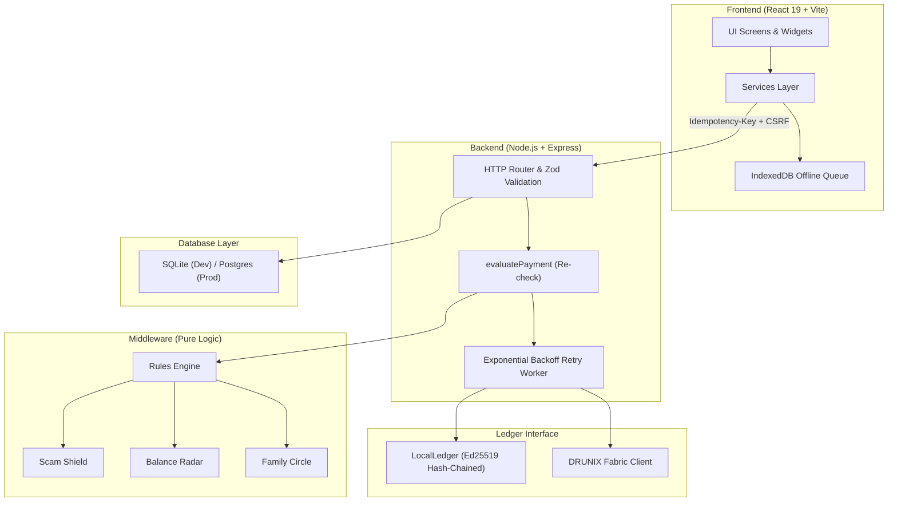
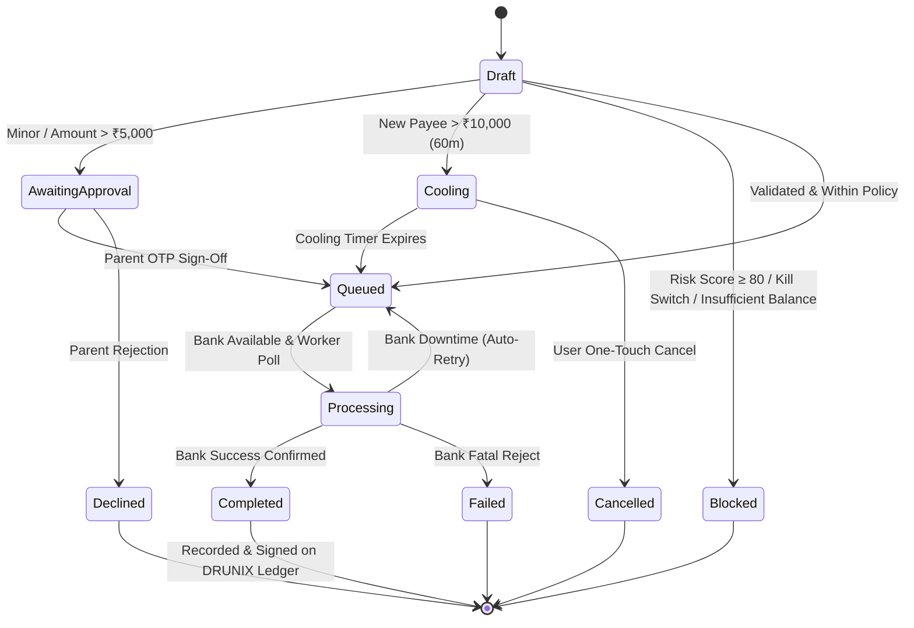
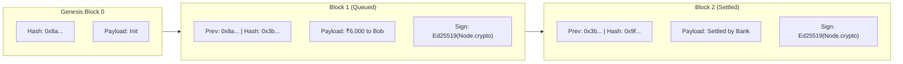
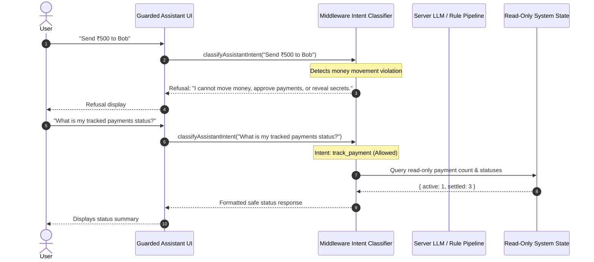

# CitiPay Architecture

CitiPay is a Next-Generation UPI & Ledger Payments Application built for the DRUNIX Hackathon 2026 (NPCI x Citi).

> **Core Philosophy**: Never hold customer money. CitiPay queues payment requests and moves funds only upon explicit bank confirmation, recording every state transition as a cryptographically signed, tamper-evident entry on the DRUNIX ledger.

---

## 1. System Topology & Layers

The system follows a strict unidirectional rule hierarchy:
- **`guideware/`**: Single source of truth for numeric policy thresholds, limits, compliance rules, and threat models.
- **`middleware/`**: Pure, tested JavaScript containing zero IO. Encapsulates payment state machines, heuristic scam scores, bank-down protection, and assistant guardrails.
- **`backend/`**: Express HTTP authority. Re-evaluates every incoming transaction, executes Ed25519 hash-chain signatures, and manages the retry worker.
- **`frontend/`**: React 19 + Vite client using Claymorphism and responsive design. Communicates strictly through a typed service layer.

---

## 2. Payment Lifecycle & State Machine

Every payment starts in `draft` state and transitions deterministically through the middleware state machine:

---

## 3. Cryptographic Ledger & Tamper Evidence

Every transaction transition writes an Ed25519-signed block to the ledger:
- **`index`**: Incremental sequential block ID.
- **`previousHash`**: SHA-256 hash of block `n-1` (Genesis block = `"0"`).
- **`payload`**: `{ paymentId, status, amount, payee, timestamp }`.
- **`signature`**: Cryptographic Ed25519 signature of `SHA256(index + previousHash + payload)`.
- Verification endpoint `GET /ledger/verify` validates the integrity of the chain in linear time.

---

## 4. Guarded Assistant Architecture

The assistant operates strictly through read-only tools and hard policy guardrails defined in `guideware/ai-policy.js` and `middleware/assistant-guardrails.js`.

---

## 5. Security & Threat Mitigation Summary

| Threat (STRIDE) | Countermeasure |
|---|---|
| **Spoofing** | Salted HMAC mobile authentication, constant-time OTP comparison, 5-attempt lockout, single-use tokens. |
| **Tampering** | Server-side `evaluatePayment` re-evaluation; client never dictates amounts, statuses, or limits. |
| **Repudiation** | Ed25519 signed ledger entries and audit logging for approvals, cancellations, and mandate toggles. |
| **Information Disclosure** | Never store full bank account numbers (masked to last 4 digits); zero collection of UPI PINs; strict log redaction via Pino. |
| **Denial of Service** | Bounded offline queue with IndexedDB idempotency; strict Express rate-limiting (300 req/min). |
| **Elevation of Privilege** | Guardianship OTP gate enforces minor status (<18) before linking bank accounts or sending funds. |
